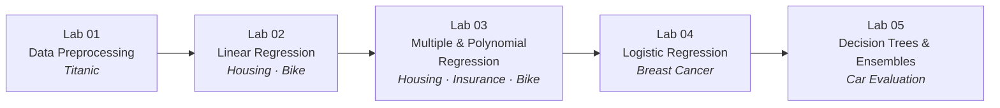

# Machine Learning Practical Labs

A collaborative university coursework repository for the **Machine Learning** practical track. The project covers the full introductory machine learning workflow — data cleaning, exploratory analysis, feature engineering, and model building — across both **regression** and **classification** problems.


---

## Overview

This repository is maintained by a six-member team as part of the Machine Learning practical course. Each lab applies the concepts covered in the lectures — learning paradigms, preprocessing, feature scaling, and supervised learning — to real-world datasets.

The work is organized by lab, with each notebook documenting its own problem statement, dataset, methodology, and evaluation. Labs 01–03 focus on regression; Labs 04–05 move into classification.

> **Progression at a glance** — the labs build on each other, from raw data cleaning through regression to classification and model tuning:



## Course Information

| | |
|---|---|
| **Course** | Machine Learning |
| **Instructor** | Dr. Marwa Mamdouh |
| **Program** | Third Year — First Semester |
| **Credit Hours** | 3 |
| **Type** | University practical (labs) |

## Repository Structure

```
ML-Project/
├── Lab01/
│   ├── Lab 1.ipynb                              # Data preprocessing on the Titanic dataset
│   └── Titanic.csv
├── Lab02/
│   ├── lab2-HOUSEPRICE_LinearRegression.ipynb   # King County house price model
│   ├── kc_house_data.csv
│   └── team/
│       ├── pre_processing.ipynb                 # Motorcycle sales preprocessing
│       ├── USA_Housing_LinearRegression.ipynb   # USA housing price model
│       ├── USA_Housing.csv
│       └── BIKE DETAILS.csv
├── Lab03/
│   ├── HOUSEPRICE_multiple_Regeression.ipynb    # Multiple linear regression on King County
│   ├── Polynomial_Regression2.ipynb             # Polynomial regression on medical insurance
│   ├── kc_house_data.csv
│   ├── insurance.csv
│   └── team/
│       ├── multi_features.ipynb                 # Multiple regression on bike sales
│       ├── Polynomial.ipynb                     # Polynomial regression on bike sales
│       └── BIKE DETAILS.csv
├── Lab04/
│   ├── Logistic Regression.ipynb                # Binary classification on breast cancer data
│   └── data.csv
├── Lab05/
│   ├── decision_tree_classifier_tutorial.ipynb  # Decision trees, ensembles, and tuning
│   └── car_evaluation.csv
├── requirements.txt
└── README.md
```

## Labs

### Lab 01 — Data Preprocessing (Titanic)

Foundations of cleaning a raw dataset before any model is fitted:

- Handling missing values (median imputation, mode imputation, column removal)
- Encoding categorical variables with one-hot encoding (`get_dummies`)
- Splitting data into training and testing sets
- Standardizing numeric features with `StandardScaler`

### Lab 02 — Linear Regression

Applied regression modeling across three datasets:

| Notebook | Dataset | Task |
|---|---|---|
| `lab2-HOUSEPRICE_LinearRegression.ipynb` | King County house sales | Predict house `price` from features such as living area and grade |
| `team/USA_Housing_LinearRegression.ipynb` | USA Housing | Predict `Price` from average area income and related features |
| `team/pre_processing.ipynb` | Motorcycle sales | Clean and explore the dataset ahead of sales prediction |

Common workflow across the lab:

1. **Data loading & inspection** — `shape`, `head`, `info`, `describe`
2. **Cleaning** — dropping unnecessary columns, checking nulls
3. **Exploratory Data Analysis** — distributions, boxplots, scatter plots, correlation heatmaps
4. **Feature engineering** — outlier removal via IQR, extracting month/year from dates
5. **Train/test split** — held-out evaluation sets
6. **Modeling** — `LinearRegression` from scikit-learn
7. **Evaluation** — MAE, MSE, RMSE, and R² (`score`)

### Lab 03 — Multiple & Polynomial Regression

Extends the regression work with richer feature handling and non-linear models.

#### `HOUSEPRICE_multiple_Regeression.ipynb` — Multiple Linear Regression

Predicts King County house `price` from **19 features** (bedrooms, bathrooms, square footage, grade, location, etc.) on `kc_house_data.csv` (21,613 rows × 21 columns).

- Drops the `date` column, then splits 70/30 (`random_state=101`)
- Fits `LinearRegression` and inspects the intercept and per-feature coefficients
- Compares **Actual vs. Predicted** prices side by side

| Metric | Value |
|---|---|
| R² (train) | 0.70 |
| R² (test) | 0.71 |
| MAE | 126,051.39 |
| MSE | 41,054,725,150.16 |

#### `Polynomial_Regression2.ipynb` — Polynomial Regression

Predicts medical `charges` from the insurance dataset (`insurance.csv`, 1,338 rows) using a non-linear model.

- Encodes categorical columns (`sex`, `smoker`, `region`) to numeric
- Splits 75/25 (`random_state=1`) and scales with `StandardScaler`
- Expands features with `PolynomialFeatures(degree=3)`, then fits `LinearRegression`

| Metric | Value |
|---|---|
| R² (train) | 0.856 |
| R² (test) | 0.836 |
| MAE (train) | 2,765.40 |
| MAE (test) | 2,767.14 |

#### `team/` — Bike sales regression

Two team notebooks apply the same regression techniques to `BIKE DETAILS.csv` (1,061 rows):

| Notebook | Approach | Result |
|---|---|---|
| `multi_features.ipynb` | Multiple linear regression on `year`, `km_driven`, and `ex_showroom_price` | Test R² = 0.86; MSE = 227,671,573.86 |
| `Polynomial.ipynb` | Encodes `seller_type`/`owner`, imputes missing prices, degree-3 polynomial features | Train R² = 0.80; test R² = −16.14 (severe overfitting) |

> The degree-3 bike model is retained for comparison: its negative test R² demonstrates how high-degree polynomials can generalize poorly without regularization or cross-validation.

#### Lab 03 workflow

1. **Data loading** — read the CSV and inspect structure
2. **Encoding** — map categorical values to numeric codes
3. **Split & scale** — train/test split followed by `StandardScaler`
4. **Feature expansion** — polynomial features to capture non-linearity
5. **Modeling** — `LinearRegression` over the transformed feature space
6. **Evaluation** — MAE and R² for both train and test sets

### Lab 04 — Logistic Regression (Breast Cancer Diagnosis)

An introduction to **binary classification** using the Breast Cancer Wisconsin dataset (`data.csv`, 569 rows × 33 columns).

- Target: `diagnosis`, mapped `M → 0` (malignant) and `B → 1` (benign)
- Feature: `radius_mean` (single predictor) — the notebook also inspects nulls and duplicates during EDA
- Stratified 75/25 split (`random_state=42`): 426 training and 143 test samples
- Fits `LogisticRegression`, inspects the learned decision boundary, and evaluates with accuracy, confusion matrix, and classification report
- Visualizes the sigmoid probability curve with the 0.5 threshold and boundary line
- Demonstrates inference on a new measurement (`radius_mean = 14.5` → benign, probability 0.550)

| Result | Value |
|---|---|
| Weight (w) / bias (b) | −1.029 / 15.125 |
| Decision boundary (`radius_mean`) | 14.70 |
| Test accuracy | 0.8601 |
| Confusion matrix | `[[42, 11], [9, 81]]` |
| F1 (malignant / benign) | 0.81 / 0.89 |

> **Note:** The `diagnosis` mapping (0 = malignant, 1 = benign) means `predict_proba[:, 1]` is the probability of *benign*. The plot legend in the notebook currently labels this curve as `P(malignant | x)`; adjust the label if you present the figure.

### Lab 05 — Decision Trees & Ensemble Methods (Car Evaluation)

The most extensive lab: an end-to-end classification study on the Car Evaluation dataset (`car_evaluation.csv`, 1,728 rows × 7 columns), adapted from a Kaggle tutorial.

**Dataset and preparation**

- Features: `buying`, `maint`, `doors`, `persons`, `lug_boot`, `safety`; target: `class`
- Target distribution is imbalanced: `unacc` 1,210, `acc` 384, `good` 69, `vgood` 65; no missing values
- 80/20 split (`random_state=42`): 1,382 training and 346 test rows
- Ordinal encoding with `category_encoders.OrdinalEncoder`
- SMOTE oversampling explored to balance the training classes (975 samples per class)

**Modeling and tuning**

- Two baseline `DecisionTreeClassifier` models (`gini` and `entropy`, both `max_depth=3`) with tree visualizations via Graphviz
- `GridSearchCV` over 126 decision-tree configurations (5-fold CV)
- Additional tuned baselines: `LogisticRegression` (24 configurations) and `RandomForestClassifier` (216 configurations)
- Confusion matrices, classification reports, and a multi-class ROC/AUC plot for model comparison

| Model | Best parameters (tuned models) | CV accuracy | Test accuracy |
|---|---|---:|---:|
| Decision tree — Gini (`max_depth=3`) | — | — | 0.8179 |
| Decision tree — Entropy (`max_depth=3`) | — | — | 0.8179 |
| Decision tree — tuned | `entropy`, `max_depth=8`, `min_samples_split=10` | 0.9262 | **0.9422** |
| Logistic regression — tuned | `C=1`, `penalty=l2`, `solver=saga` | 0.7721 | 0.7543 |
| Random forest — tuned | `entropy`, `max_depth=20`, `n_estimators=200` | 0.9667 | **0.9682** |

The tuned decision tree trains at 0.9327 vs. 0.9422 on test data, so it shows no sign of overfitting. The tuned random forest reaches 0.9682 on test but 1.0 on train, indicating it memorizes the training set.

> **Note:** SMOTE-resampled arrays are computed but the reported models are fitted on the original training split. Re-running the comparison with `X_train_resampled` / `y_train_resampled` would make the balancing step effective.

## Models & Metrics

### Regression

| Model | Lab | Dataset (rows) | Test R² | Test MAE |
|---|---|---|---|---|
| Single-feature Linear Regression | 02 | King County | — | — |
| Multiple Linear Regression | 03 | King County (21,613) | 0.71 | 126,051.39 |
| Polynomial Regression (deg. 3) | 03 | Insurance (1,338) | 0.84 | 2,767.14 |
| Multiple Linear Regression | 03 | Bike sales (1,061) | 0.86 | — |

### Classification

| Model | Lab | Dataset (rows) | Test accuracy | Macro F1 |
|---|---|---|---|---|
| Logistic Regression (single feature) | 04 | Breast Cancer (569) | 0.8601 | 0.85 |
| Decision Tree — tuned | 05 | Car Evaluation (1,728) | 0.9422 | 0.7791 |
| Random Forest — tuned | 05 | Car Evaluation (1,728) | 0.9682 | 0.9024 |
| Logistic Regression — tuned | 05 | Car Evaluation (1,728) | 0.7543 | — |

## Tech Stack

| Tool | Purpose |
|---|---|
| Python 3 | Core language |
| pandas / NumPy | Data manipulation and numerics |
| Matplotlib / seaborn | Visualization and EDA |
| scikit-learn | Preprocessing, splitting, models, and grid search |
| category_encoders | Ordinal encoding of categorical features |
| imbalanced-learn | SMOTE oversampling for imbalanced classes |
| Graphviz | Rendering decision-tree diagrams |
| Jupyter Notebook | Experimentation and reporting |

Dependencies are pinned in [`requirements.txt`](requirements.txt).

## Getting Started

```bash
# 1. Clone the repository
git clone https://github.com/asaerxd6767/ML-Project.git
cd ML-Project

# 2. Create and activate a virtual environment
python -m venv .venv
# Windows
.venv\Scripts\activate
# macOS / Linux
source .venv/bin/activate

# 3. Install dependencies
pip install -r requirements.txt

# 4. Launch Jupyter
jupyter notebook
```

Then open any notebook under `Lab01/` through `Lab05/`. Datasets are stored alongside their notebooks, so run cells from the notebook's own directory (or update the file paths) to load the CSVs.

> **Reproducibility notes**
> - `Lab04/Logistic Regression.ipynb` reads its CSV from a machine-specific absolute path (`C:\Users\LOQ\Downloads\archive (3)\data.csv`). Change it to `pd.read_csv("data.csv")` to use the repository copy.
> - `Lab05/decision_tree_classifier_tutorial.ipynb` contains Google Colab mount/`cd` cells and in-notebook `!pip install` calls. Skip those cells locally (or guard them) and rely on `requirements.txt`.
> - Rendering the tree diagrams in Lab 05 requires the Graphviz **system** executable (`dot`) in addition to the Python package.

## Evaluation

Models are assessed with standard metrics appropriate to each task:

**Regression (Labs 02–03)**

- **MAE** — mean absolute error
- **MSE / RMSE** — mean squared error and its square root
- **R² score** — proportion of variance explained, reported for train and test sets

**Classification (Labs 04–05)**

- **Accuracy** — proportion of correct predictions
- **Confusion matrix** — breakdown of true/false positives and negatives
- **Precision / Recall / F1** — per-class performance, plus macro and weighted averages
- **ROC / AUC** — multi-class discrimination, plotted with a one-vs-rest strategy

---

## Collaborators

This project was designed, implemented, and reviewed by a team of six contributors. The contributions below reflect shared ownership across the different lab workstreams rather than individual ranking.

| Member | GitHub | Focus |
|---|---|---|
| **Asser Mohammed** | [@asaerxd6767](https://github.com/asaerxd6767) | Repository setup, Lab 02 house-price notebooks, Lab 03 modeling, version control |
| **Habiba Mahmoud** | [@habibamahmoud13](https://github.com/habibamahmoud13) | Dataset sourcing and preprocessing |
| **Mostafa Aiman** | [@mostafaelwazzany](https://github.com/mostafaelwazzany) | Exploratory data analysis and visualization |
| **Sara Ahmed** | [@Sarsoour](https://github.com/Sarsoour) | Lab 03 modeling and preprocessing |
| **Akaber Ahmed** | — | Data cleaning and documentation |
| **Steven Mounir** | — | Model evaluation and reporting |


---

### Commit History

The project’s commit history is summarized below by contributor, linked GitHub profile, and total number of commits recorded in the repository.

| Contributor | GitHub Profile | Number of Commits |
|---|---|---:|
|  | [@mostafaelwazzany](https://github.com/mostafaelwazzany) |  |
|  | [@habibamahmoud13](https://github.com/habibamahmoud13) |  |
|  | [@asaerxd6767](https://github.com/asaerxd6767) |  |
|  | [@Sarsoour](https://github.com/Sarsoour) |  |
| **Akaber Ahmed** | — | No linked GitHub profile to attribute commits |
| **Steven Mounir** | — | No linked GitHub profile to attribute commits |

*Coursework repository for the Machine Learning practical track.*
