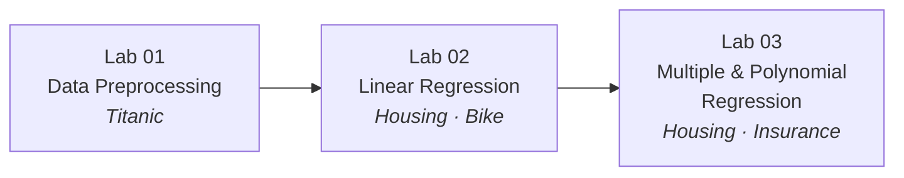

# Machine Learning — Practical Labs

A collaborative coursework repository for the **Machine Learning** practical track. It collects the lab notebooks, datasets, and supporting scripts produced throughout the semester, covering the full introductory pipeline — data cleaning, preprocessing, exploratory analysis, feature engineering, and regression modeling.


---

## Overview

This repository is maintained by a five-member team as part of the Machine Learning practical course. Each lab applies the concepts covered in the lectures — the learning paradigm, preprocessing, feature scaling, and the supervised learning workflow — to real-world datasets.

The work is organized by lab, with each notebook documenting its own problem statement, dataset, methodology, and evaluation.

> **Progression at a glance** — the labs build on each other, moving from raw cleaning to increasingly expressive regression models:



## Course Information

| | |
|---|---|
| **Course** | Machine Learning |
| **Instructor** | Dr. Marwa Mamdouh |
| **Program** | Third Year — First Semester |
| **Credit Hours** | 3 |
| **Type** | University practical (labs) |

## Repository Structure

```
ML-Project/
├── Lab01/
│   ├── Lab 1.ipynb                              # Data preprocessing on the Titanic dataset
│   └── Titanic.csv
├── Lab02/
│   ├── lab2-HOUSEPRICE_LinearRegression.ipynb   # King County house price model
│   ├── kc_house_data.csv
│   └── team/
│       ├── pre_processing.ipynb                 # Motorcycle sales preprocessing
│       ├── USA_Housing_LinearRegression.ipynb   # USA housing price model
│       ├── USA_Housing.csv
│       └── BIKE DETAILS.csv
├── Lab03/
│   ├── HOUSEPRICE_multiple_Regeression.ipynb    # Multiple linear regression on King County
│   ├── Polynomial_Regression2.ipynb             # Polynomial regression on medical insurance
│   ├── kc_house_data.csv
│   └── insurance.csv
├── requirements.txt
└── README.md
```

## Labs

### Lab 01 — Data Preprocessing (Titanic)

Foundations of cleaning a raw dataset before any model is fitted:

- Handling missing values (median imputation, mode imputation, column removal)
- Encoding categorical variables with one-hot encoding (`get_dummies`)
- Splitting data into training and testing sets
- Standardizing numeric features with `StandardScaler`

### Lab 02 — Linear Regression

Applied regression modeling across three datasets:

| Notebook | Dataset | Task |
|---|---|---|
| `lab2-HOUSEPRICE_LinearRegression.ipynb` | King County house sales | Predict house `price` from features such as living area and grade |
| `team/USA_Housing_LinearRegression.ipynb` | USA Housing | Predict `Price` from average area income and related features |
| `team/pre_processing.ipynb` | Motorcycle sales | Clean and explore the dataset ahead of sales prediction |

Common workflow across the lab:

1. **Data loading & inspection** — `shape`, `head`, `info`, `describe`
2. **Cleaning** — dropping unnecessary columns, checking nulls
3. **Exploratory Data Analysis** — distributions, boxplots, scatter plots, correlation heatmaps
4. **Feature engineering** — outlier removal via IQR, extracting month/year from dates
5. **Train/test split** — held-out evaluation sets
6. **Modeling** — `LinearRegression` from scikit-learn
7. **Evaluation** — MAE, MSE, RMSE, and R² (`score`)

### Lab 03 — Multiple & Polynomial Regression

Extends the regression work with richer feature handling and non-linear models.

#### `HOUSEPRICE_multiple_Regeression.ipynb` — Multiple Linear Regression

Predicts King County house `price` from **19 features** (bedrooms, bathrooms, square footage, grade, location, etc.) on `kc_house_data.csv` (21,613 rows × 21 columns).

- Drops the `date` column, then splits 70/30 (`random_state=101`)
- Fits `LinearRegression` and inspects the intercept and per-feature coefficients
- Compares **Actual vs. Predicted** prices side by side

| Metric | Value |
|---|---|
| R² (train) | 0.70 |
| R² (test) | 0.71 |
| MAE | 126,051.39 |
| MSE | 41,054,725,150.16 |

#### `Polynomial_Regression2.ipynb` — Polynomial Regression

Predicts medical `charges` from the insurance dataset (`insurance.csv`, 1,338 rows) using a non-linear model.

- Encodes categorical columns (`sex`, `smoker`, `region`) to numeric
- Splits 75/25 (`random_state=1`) and scales with `StandardScaler`
- Expands features with `PolynomialFeatures(degree=3)`, then fits `LinearRegression`

| Metric | Value |
|---|---|
| R² (train) | 0.856 |
| R² (test) | 0.836 |
| MAE (train) | 2,765.40 |
| MAE (test) | 2,767.14 |

#### Lab 03 workflow

1. **Data loading** — read the CSV and inspect structure
2. **Encoding** — map categorical values to numeric codes
3. **Split & scale** — train/test split followed by `StandardScaler`
4. **Feature expansion** — polynomial features to capture non-linearity
5. **Modeling** — `LinearRegression` over the transformed feature space
6. **Evaluation** — MAE and R² for both train and test sets

## Models & Metrics

| Model | Lab | Dataset (rows) | Test R² | Test MAE |
|---|---|---|---|---|
| Single-feature Linear Regression | 02 | King County | — | — |
| Multiple Linear Regression | 03 | King County (21,613) | 0.71 | 126,051.39 |
| Polynomial Regression (deg. 3) | 03 | Insurance (1,338) | 0.84 | 2,767.14 |

## Tech Stack

| Tool | Purpose |
|---|---|
| Python 3 | Core language |
| pandas / NumPy | Data manipulation and numerics |
| Matplotlib / seaborn | Visualization and EDA |
| scikit-learn | Preprocessing, splitting, and models |
| Jupyter Notebook | Experimentation and reporting |

Dependencies are pinned in [`requirements.txt`](requirements.txt).

## Getting Started

```bash
# 1. Clone the repository
git clone https://github.com/asaerxd6767/ML-Project.git
cd ML-Project

# 2. Create and activate a virtual environment
python -m venv .venv
# Windows
.venv\Scripts\activate
# macOS / Linux
source .venv/bin/activate

# 3. Install dependencies
pip install -r requirements.txt

# 4. Launch Jupyter
jupyter notebook
```

Then open any notebook under `Lab01/`, `Lab02/`, or `Lab03/`. Datasets are stored alongside their notebooks, so run cells from the notebook's own directory (or update the file paths) to load the CSVs.

## Evaluation

Models across Labs 02 and 03 are assessed with standard regression metrics:

- **MAE** — mean absolute error
- **MSE / RMSE** — mean squared error and its square root
- **R² score** — proportion of variance explained, reported for both train and test sets

---

## Collaborators

This project was designed, implemented, and reviewed by a team of five. Contributions listed below reflect shared ownership across the lab workstreams rather than individual ranking.

| Member | GitHub | Focus |
|---|---|---|
| **Asser Mohammed** | [@asaerxd6767](https://github.com/asaerxd6767) | Repository setup, Lab 02 house-price notebooks, Lab 03 modeling, version control |
| **Habiba Mahmoud** | [@habibamahmoud13](https://github.com/habibamahmoud13) | Dataset sourcing and preprocessing |
| **Mostafa Aiman** | [@mostafaelwazzany](https://github.com/mostafaelwazzany) | Exploratory data analysis and visualization |
| **Akaber Ahmed** | — | Data cleaning and documentation |
| **Steven Mounir** | — | Model evaluation and reporting |

### Commit History

The repository history below records the incremental work that built each lab.

| Commit | Date | Description |
|---|---|---|
| `570c6c6` | 2026-10-09 | Initial commit |
| `6275431` | 2026-10-09 | Add lab notebooks and `requirements.txt` |
| `682e10a` | 2026-10-09 | Add `kc_house_data.csv` to `Lab02` |
| `0cbd476` | 2026-10-09 | Merge pull request #1 from `Asser` |
| `52998e6` | 2026-10-10 | Add pre-processing notebook for motorcycle sales prediction |
| `dfdb93a` | 2026-10-10 | Merge pull request #2 from `Asser` |
| `7e9a1c6` | 2026-10-11 | Improve functionality and performance of notebooks |
| `7ad47c1` | 2026-10-12 | Add USA Housing Price Prediction notebook |
| `f0ab62e` | 2026-10-13 | Enhance user experience and optimize performance |
| `11d7b11` | 2026-10-13 | Lab 02 — Linear Regression (single feature) |
| `b0581db` | 2026-10-13 | Remove `make_nb.py` and add `README.md` |
| `756755a` | 2026-10-13 | Merge branch `Asser` into `main` |
| `cc808ac` | 2026-10-13 | Merge branch `main` into `Asser` |
| `ee92921` | 2026-10-15 | Add Lab 03 — multiple & polynomial regression notebooks |
| `30f5331` | 2026-10-15 | Merge `origin/main` into `Asser` |

---

*Coursework repository for the Machine Learning practical track.*
